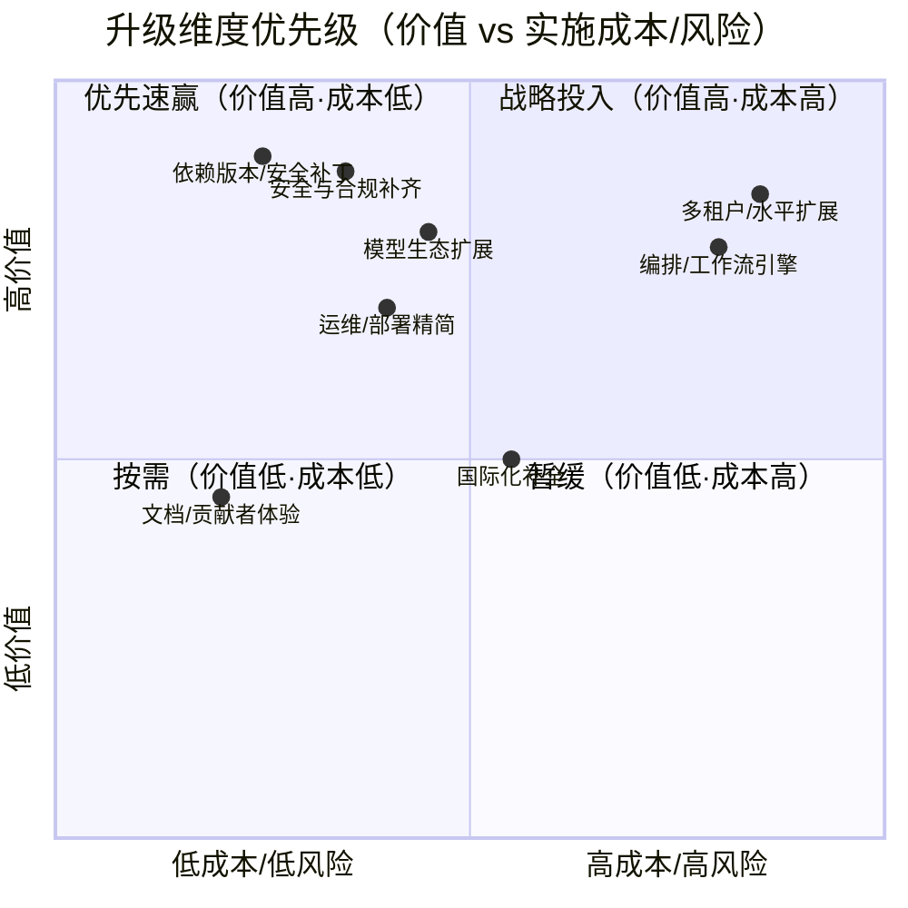
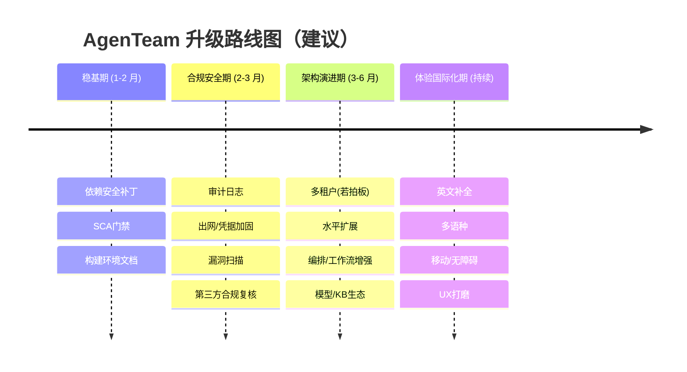

# AgenTeam（群策）升级思路分析

> - **版本基线**：v0.2.0（Apache-2.0）
> - **文档日期**：2026-10-12
> - **作者**：产品组（许清楚）
> - **分析性质**：仅现状评估与路线建议，**未修改任何代码**
> - **依据来源**：仓库 `README.md` / `AGENTS.md`、`agenteam-server/pom.xml`、`agenteam-web/package.json`、`deploy/*`、`docs/*`，以及后端 `configuration` / `service` / `model` 包与前端的 `lib/i18n` 实现

---

## 0. 分析依据（已核对的关键事实）

| 类别 | 已确认事实 |
| --- | --- |
| 后端 | Java 21 · Spring Boot **4.1.1** · AgentScope **2.0.3** · MyBatis-Plus **3.5.17**（`mybatis-plus-spring-boot4-starter`）· Flyway + MariaDB Connector/J **3.5.10** · Redis（响应式 + Session）· Spring Security Crypto · springdoc-openapi **3.1.0** · AWS S3 SDK **2.49.6** · jsoup **1.22.2** · PDFBox **3.0.8** |
| 前端 | Next.js **16.3.2** · React **19.2.8** · TypeScript 5 · Tailwind v4 · shadcn **4.21** · @assistant-ui/react 0.15.17 · @xyflow/react 12 · tiptap 3.31 · ogl · pnpm **11.15.1**（锁文件 374KB） |
| 部署 | Docker Compose 共 **8** 套变体（base/dev/single/split/shared-mysql/low-memory/registry/external-mysql）；`configure.sh`/`configure.ps1` 生成 `.env`；独立 `sandbox` 镜像（浏览器 Playwright 1.64 + Git）；低内存模式面向 **4GB** 主机 |
| 模型生态 | OpenAI 兼容抽象（`ModelProfile` + 自定义 base URL/密钥）；MCP 客户端（`RemoteMcpSession` / `RestrictedMcpTransport`，带出网限制） |
| 安全 | 凭据落库加密（`PayloadEncryption` / `CredentialService`）；工具出网受限（`RestrictedHttpClient`）；生产期强校验（`ProductionSettingsValidation`：强制 HTTPS、Secure Cookie、可信代理单地址白名单） |
| 供应链 | 维护第三方源码索引（SHA-256 校验）；`scripts/release/` 有声明采集工具；MariaDB 驱动为 **LGPL-2.1** |
| 国际化 | 双语（zh-CN 源语言 + en）；en 拆为 24 个特性 JSON 字典（约 274KB）；`test:i18n` 校验 key 覆盖 |

---

## 1. 现状评估

### 1.1 技术栈成熟度矩阵

| 组件 | 版本阶段 | 成熟度 | 生态兼容性 | 风险等级 |
| --- | --- | --- | --- | --- |
| Spring Boot 4.1.1 | 大版本首发后早期 | 中 | 需专用 `spring-boot4` 启动器（MyBatis-Plus 已适配，第三方库滞后） | 🔴 高 |
| Java 21 | LTS | 高 | 高 | 🟢 低 |
| AgentScope 2.0.3 | 框架早期（2.x） | 低-中 | 社区小、文档少、上游变动快 | 🔴 高 |
| Next.js 16.3.2 | 大版本首发 | 中 | React 19 生态仍在追赶 | 🔴 高 |
| React 19.2.8 | 大版本 | 中-高 | 主流库基本适配 | 🟡 中 |
| MyBatis-Plus 3.5.17 | 稳定 | 高 | 需 `spring-boot4` 专用包 | 🟡 中 |
| Tailwind v4 / shadcn 4.21 | 新 | 中 | 工具链较新 | 🟡 中 |
| Docker Compose 多套部署 | 成熟 | 高 | 高 | 🟢 低（运维复杂度高） |

**总体判断**：产品已具备完整的「多智能体协作平台」骨架（对话、子智能体、技能/插件/知识库/MCP、企业微信/飞书、待办与定时任务、按项目复用上下文），**功能完整度高于版本稳定性**。风险集中在「三个很新的大版本（Spring Boot 4 / Next 16 / React 19）+ 一个年轻智能体框架（AgentScope 2）」的组合上，而非架构设计本身。

### 1.2 重点风险点

1. **Spring Boot 4 / Next.js 16 / React 19 的「新版本叠加风险」**
   - 三者均为近年大版本，官方/社区最佳实践、踩坑记录、第三方适配都还在积累期。
   - 证据：`pom.xml` 必须使用 `mybatis-plus-spring-boot4-starter`（Spring Boot 4 专用启动器），说明主流 ORM 尚未用通用坐标覆盖；`package.json` 对 `@base-ui/react`、`tiptap`、`@assistant-ui/react` 等均以精确版本钉死，反映对新版生态不确定性的防御。
   - 影响：遇到依赖冲突/行为变更时，搜索引擎可检索到的现成方案少，排障成本高；安全补丁发布节奏也不如成熟版本可预测。

2. **AgentScope 2 生态成熟度**
   - 代码深度耦合 `ReActAgent`、`RuntimeContext`、`HarnessAgent` 等 API，并存在 `AgentScope203RegressionTest`（专门守护 2.0.3 行为）。
   - 解读：团队**已经因上游变动吃过亏**才写回归测试——这是年轻框架的典型信号。框架一旦发 2.0.4+ 破坏性变更，需持续跟进。
   - 缓解已就位：版本钉死 + 回归测试 + 抽象层（`AgentModelFactory` / `WorkflowModelExecutionAdapter`）。

3. **依赖安全性与供应链**
   - 正面：项目维护第三方源码索引与 SHA-256（Apache-2.0 合规做得扎实），`scripts/release/` 有自动化采集。
   - 缺口：仓库内未见 SCA（如 Dependency-Check / Trivy / Renovate / Dependabot）自动门禁；沙箱内置 Playwright 1.64 + Chromium，是较大的供应链与镜像体积面；MariaDB 驱动为 **LGPL-2.1**，虽与 Apache-2.0 可共存，但需在发行说明中明确（已说明，属合规良好）。

4. **构建 / 部署复杂度**
   - 8 套 Compose 变体 + 配置脚本 + 独立 `sandbox` 镜像 + `sandbox-executor` 独立服务 + cgroup slice（低内存模式）——能力强大但**认知负担重**。
   - 低内存模式（4GB）资源上限：backend 512m、sandbox-executor 160m、frontend 160m、redis 64m、nginx 32m——可覆盖极小规格，但并发与对话实时性受限。
   - 构建基线要求 Java 21（本分析机仅 JDK17，无法运行）；Node 24 + pnpm 11.15.1。多 JDK/Node 版本门槛对贡献者与运维不友好。

5. **i18n 覆盖**
   - 机制清晰：zh-CN 为源语言（原文即 key），en 经 24 个特性 JSON 字典翻译，并有 `test:i18n` 强制 key 覆盖，英文覆盖面广且工程化。
   - 局限：翻译是**「显式包裹 `t()` 才译」**的 opt-in 模式——未包裹的硬编码中文不会出现在英文界面；当前仅 zh-CN / en 两种语言，无 RTL/其它语种，无后端报错/日志的本地化。

### 1.3 技术债务清单

| 债务项 | 表现 | 建议优先级 |
| --- | --- | --- |
| 新版本叠加风险 | SB4 + Next16 + React19 + AgentScope2 同时很新 | P0 |
| 构建环境门槛 | 强制 Java 21（贡献者常被 JDK17 卡住） | P1 |
| 部署认知负担 | 8 套 Compose + 配置脚本，选型成本高 | P1 |
| 自动化安全门禁缺失 | 无 SCA/镜像扫描/Renovate | P1 |
| 多租户/水平扩展未明 | 当前 enterprise/workspace 模型，缺 SaaS 化与横向扩容方案 | P2（待拍板） |
| 英文以外的本地化 | 仅 zh-CN/en，无日志/报错本地化 | P2 |

---

## 2. 「升级」的多维解读与优先级

> 把「升级」拆成互相独立、可分别排期的维度。价值=对产品竞争力/稳定性/合规的贡献；优先级基于价值与紧迫度综合判定。

| 维度 | 主要内容 | 价值 | 优先级 | 说明 |
| --- | --- | --- | --- | --- |
| 依赖版本升级 | 钉版依赖的安全补丁、Spring Boot/Next/React/AgentScope 小版本跟进、SCA 门禁 | 高（稳定性+安全） | **P0** | 不直接加功能，但决定「能不能安心用」；AgentScope 2.x 须随上游持续跟进 |
| 安全与合规升级 | 凭据加密完善、出网白名单、审计日志、生产强校验、第三方许可合规、漏洞扫描、GDPR/等保路径 | 高（信任+可售） | **P0** | 已有较好基础（加密、RestrictedHttpClient、ProductionSettingsValidation），补齐审计与扫描即具备企业落地门槛 |
| 运维 / 部署升级 | 精简 Compose 选型、低内存/外部 MySQL 模式完善、镜像瘦身、健康检查、可观测性（Prometheus 已接入）、备份恢复手册 | 中-高 | **P1** | 降低自建门槛，扩大可部署场景（小机器、已有 MySQL） |
| 架构 / 可扩展性升级 | 多租户（行级/按实例）、水平扩展（无状态化、会话外置已具备）、Agent 编排引擎增强、工作流引擎增强 | 高（但重） | **P1/P2** | 价值高但投入大；是否做多租户需先拍板（见 §4） |
| 模型生态扩展 | 更多厂商预置（DeepSeek/通义/智谱/Claude/Azure）、本地模型（Ollama/vLLM）、Embedding/Rerank 与向量库后端、MCP 市场/注册中心 | 高（差异化） | **P1** | 当前 OpenAI 兼容 + MCP 已具扩展性，补齐预置与 KB 检索栈即显著提升上手体验 |
| 体验 / 国际化升级 | 英文覆盖补全、更多语种、表单/移动端/无障碍、对话与编排 UX 打磨 | 中 | **P2** | 不阻塞使用，影响海外与团队 adoption |
| 文档 / 贡献者体验升级 | JDK/Node 版本前置说明、错误码文档、二次开发指南 | 中 | **P2** | 提升社区活跃度与可持续维护 |

**优先级总览图（价值 vs 实施成本/风险）**

---

## 3. 升级路线图

建议分四期推进，先做「稳基 + 合规安全」，再视拍板结果进入「架构演进」与「体验国际化」。

| 阶段 | 目标 | 关键动作 | 预期收益 | 主要风险 | 缓解措施 |
| --- | --- | --- | --- | --- | --- |
| **稳基期** | 让新版本组合「稳得住、可复现」 | ①建立 SCA/镜像扫描（Trivy + Dependency-Check）+ Renovate；②AgentScope 2.x 小版本跟进与回归；③补全 JDK21/Node24 构建文档与 CI 矩阵；④统一依赖钉版策略 | 可重复构建、漏洞可见、贡献者不再被环境卡住 | 升级引入回归；CI 成本 | 回归测试套件（已含 AgentScope203 回归）+ 灰度发布 |
| **合规安全期** | 达到企业可落地门槛 | ①操作/访问审计日志；②凭据与出网策略复核（含 MCP/插件）；③漏洞扫描接入发布流水线；④第三方许可合规复核（LGPL 驱动等）；⑤生产强校验清单化 | 满足等保/客户安全问卷，可签企业客户 | 审计影响性能；合规范围蔓延 | 异步写审计、采样；合规范围先聚焦国内企业 |
| **架构演进期** | 可规模化、可编排 | ①多租户方案落地（若拍板）；②无状态化与水平扩展验证（Redis Session 已具备）；③Agent 编排与可视化工作流增强；④模型/KB 生态（厂商预置、本地模型、向量后端） | 支撑中大型团队与 SaaS；差异化竞争力 | 多租户改动面大、数据隔离风险 | 先「按实例隔离」再「行级隔离」；隔离由集成测试守护 |
| **体验国际化期** | 更广 adoption | ①英文 key 覆盖 100% + 更多语种；②移动端/响应式与无障碍；③对话/编排 UX 打磨；④错误码与二次开发文档 | 海外与多元团队可用，社区增长 | 翻译维护成本；多端一致性 | i18n 测试门禁、贡献者翻译流程 |

---

## 4. 待明确事项（需团队 / 用户拍板）

| # | 待拍板问题 | 影响范围 | 建议拍板方 |
| --- | --- | --- | --- |
| Q1 | **目标部署规模**：个人/小团队自部署、企业内部、还是多租户 SaaS？ | 是否做多租户、扩展方案、运维投入 | 产品 + 商业 |
| Q2 | **是否长期维护 Java 21 基线**？还是放宽到 JDK17 兼容？ | 构建门槛、依赖选型 | 技术负责人 |
| Q3 | **是否做多租户**？行级隔离 vs 按实例隔离？ | 架构演进期工作量、数据隔离风险 | 架构 + 产品 |
| Q4 | **模型厂商扩展范围**：优先补全哪些（国产厂商/本地模型/Claude/Azure）？是否做向量检索栈？ | 模型生态扩展优先级 | 产品 |
| Q5 | **是否需要合规审计**（等保/ISO/GDPR）？目标市场是国内还是出海？ | 合规安全期范围 | 商务 + 法务 |
| Q6 | **编排引擎定位**：自研增强 vs 深度依赖 AgentScope？长期是否解耦？ | 架构与技术债 | 架构 |
| Q7 | **版本节奏**：是否接受「钉版 + 季度安全跟进」的保守策略，还是紧跟上游？ | 稳基期策略 | 技术负责人 |

---

## 5. 下一步建议（最优先 5 条）

1. **P0 — 先立自动化安全门禁**：引入 Trivy（镜像）+ OWASP Dependency-Check / Renovate（依赖），接入 `.github/workflows/community-checks.yml`，把「依赖漏洞可见」作为一切升级的前置条件。当前供应链合规基础好，只差自动扫描闭环。
2. **P0 — 制定「钉版 + 季度安全跟进」的版本策略**：对 Spring Boot 4、Next 16、React 19、AgentScope 2.0.3 维持钉版，保留 `AgentScope203RegressionTest` 类守护，每季度评估小版本与安全补丁，避免被上游变动「静默击穿」。
3. **P1 — 补齐企业落地的安全拼图**：在已有 `PayloadEncryption` / `RestrictedHttpClient` / `ProductionSettingsValidation` 基础上，补**操作审计日志**与**发布期漏洞扫描**，这是把「能跑」变成「能卖给企业」的关键一步。
4. **P1 — 降低部署与构建门槛**：精简 8 套 Compose 的选型引导（一键推荐），补全 JDK21/Node24 前置文档与 CI 构建矩阵，让贡献者与运维不再被环境卡住——直接提升社区活跃度与可维护性。
5. **P1 — 明确模型/KB 生态扩展路线前，先拍板 Q1/Q3/Q4**：在动手多租户或大规模编排前，先就「部署规模、多租户与否、优先厂商」达成一致，避免架构演进期返工。

---

> **附：本次分析未改动任何源代码、配置或文档（除本文件外）。** 所有结论均基于仓库既有文件核对，可作为后续立项与排期的输入。
